# Task Orbit: feature walkthrough

A guided tour of every feature, for the **student** and the **teacher** accounts. It follows the
same story as the demo video:

1. A student checks their week and asks for more time on an assignment.
2. The teacher reviews the class, posts new work with the Deadline Advisor and approves the request.
3. The student sees both results.

**Watch it:**
- [Full demo video (desktop, ~3 min)](demo/task_orbit_demo.webm)
- [Phone demo (~30 s)](demo/task_orbit_demo_mobile.webm)

> To try it yourself, run the app (see the main README) and run `scripts/seed.py`. Every demo
> account's password is `demo12345`. Student: `demo@taskorbit.in`. Teacher: `teacher@taskorbit.in`.
> The login page also has one-click **Student demo** / **Teacher demo** buttons.

---

## 1. Login and register

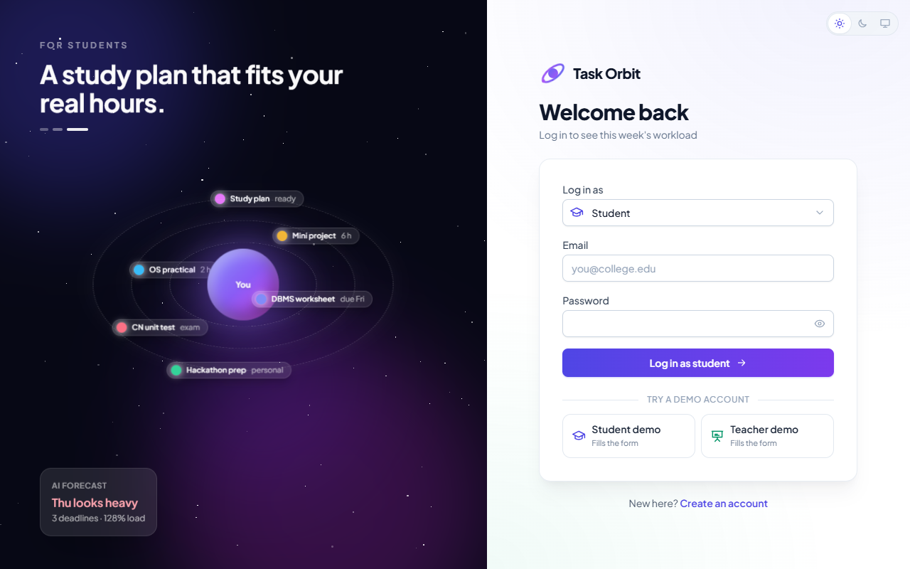

- **Animated orbit.** The left side is a live scene where your tasks orbit you like planets. It
  tilts gently with the mouse, and the headline cycles through what the app does.
- **"Log in as" dropdown.** Choose Student or Teacher. The whole screen follows your choice:

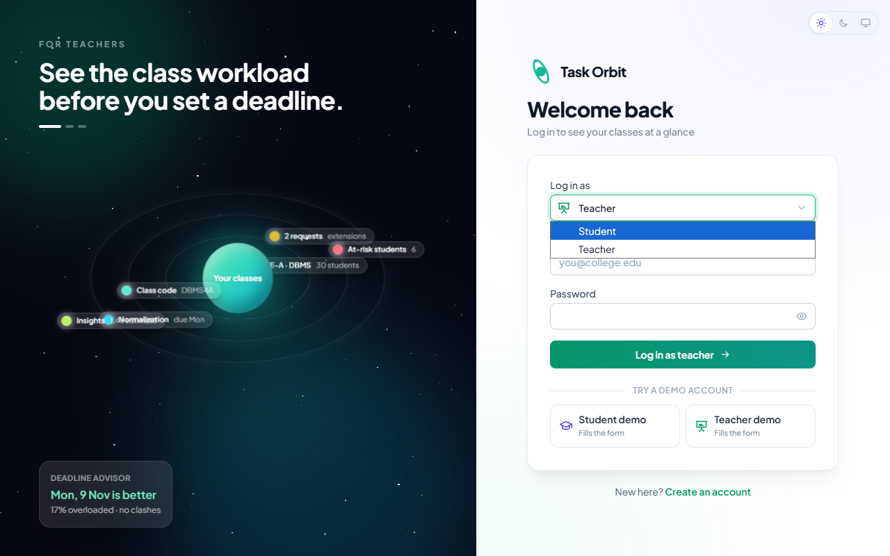

- For a teacher, classes, extension requests and at-risk students orbit instead, the colours
  switch to emerald, and the floating card shows a Deadline Advisor suggestion.
- **Clear errors.** Choosing the wrong role is refused with a hint (*"This is a teacher account.
  Choose 'Teacher' to log in."*). A failed login shakes the card.
- **Helpers.** Show/hide password, a Caps Lock warning, and one-click demo accounts (hide them in
  production with `VITE_SHOW_DEMO=false`).
- **Register.** Pick Student or Teacher. Teachers need the department's signup code, so students
  can't register as teachers. A strength meter rates the password as you type.

---

## 2. Student

### 2.1 Dashboard: "Am I in trouble this week?"

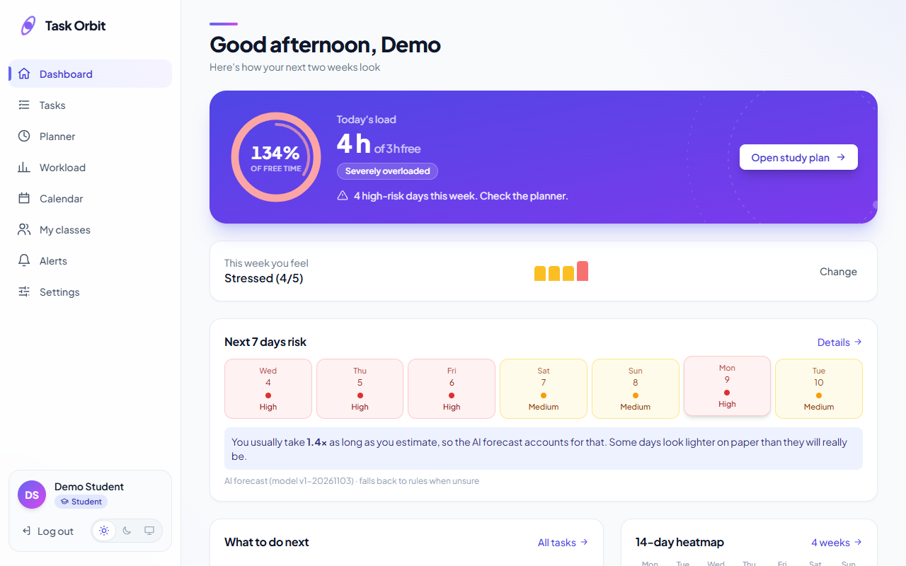

- **Today's load** as a ring gauge: the hours of work due today compared with the hours you have
  free. An inner ring shows how far over 100% you are.
- **Next 7 days risk:** an AI forecast (ML model A) for each day: low, medium or high. If you
  usually take longer than you estimate, the forecast accounts for it and tells you so.
- **Weekly stress check-in:** one tap a week ("How overloaded did you feel?"). It's shown as a
  trend and used as a signal by the ML models.
- **What to do next:** your top open tasks by priority and deadline.
- **14-day heatmap:** green, amber, red and dark red for light, busy, overloaded and severely
  overloaded. Hover a day for the hours.
- **Unread alerts:** the latest warnings, with mark-as-read.

### 2.2 Tasks

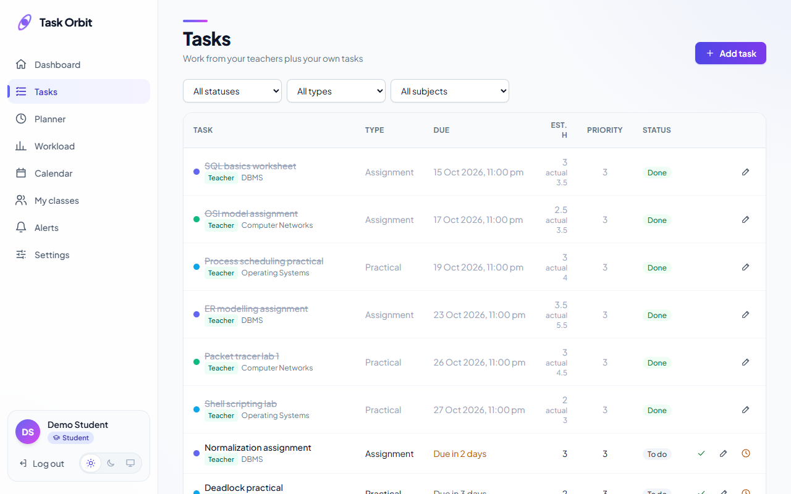

- **One list for everything.** Assignments from your teachers arrive automatically (green
  **Teacher** badge), next to your personal tasks.
- **Filters** by status, type and subject.
- **Add a task.** After saving, the app tells you at once whether your next 7 days still fit.
- **Teacher tasks are protected.** The teacher sets the title, type and deadline. You set your own
  estimate, priority, start date, status and notes.

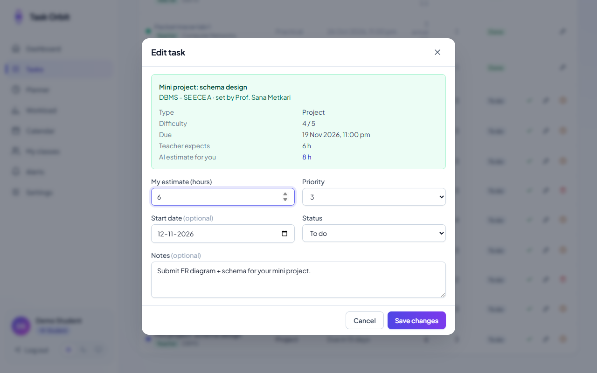

- **Smart time estimate.** For a teacher task you see what the teacher expects, an **AI estimate
  for you** (ML model B, based on your speed and your classmates' real hours) and, once
  classmates finish it, how long they really took on average.

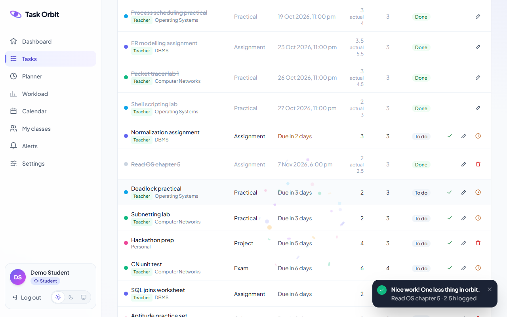

- **Mark done with real hours.** You log how long it actually took (this is the training data
  that makes the forecasts personal). A confetti burst and a toast confirm it.

### 2.3 Workload-backed extension request

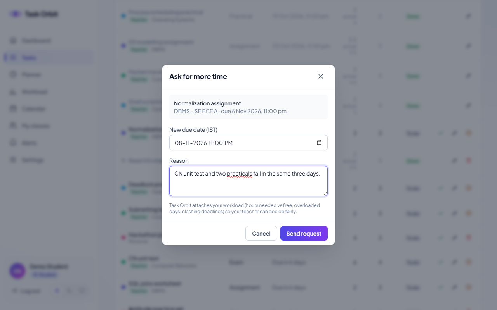

- One click (clock icon) on a teacher task. Pick a new date (up to 14 extra days) and give a reason.
- The server **attaches your real workload as evidence**: hours needed vs hours free before the
  deadline, overloaded days and clashing deadlines. The teacher decides with facts, not excuses.

### 2.4 Study planner

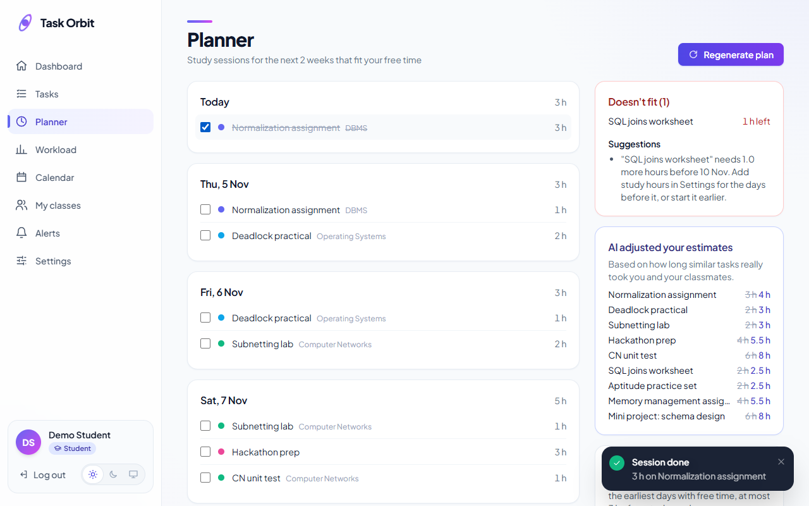

- **Generate plan** builds a day-by-day schedule within your available study hours, earliest
  deadline first, with at most 3 h of one task per day.
- **Tick sessions off** as you study (confetti included).
- **Doesn't fit:** tasks that can't fit before their deadline, with concrete suggestions.
- **AI adjusted your estimates:** where the ML model expects a task to take longer than your
  estimate, the plan uses the corrected hours.

### 2.5 Workload

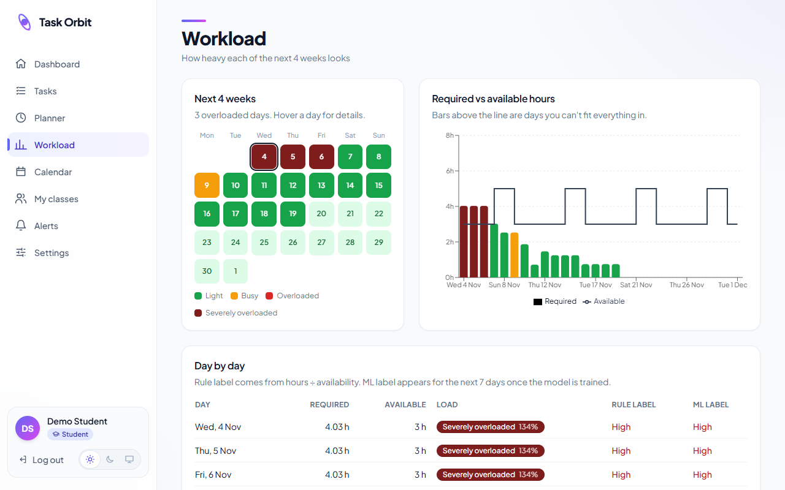

- 4-week heatmap, a chart of required vs available hours, and a day-by-day table with the
  **rule label** next to the **ML label**, so you can see where the AI disagrees.

### 2.6 Calendar

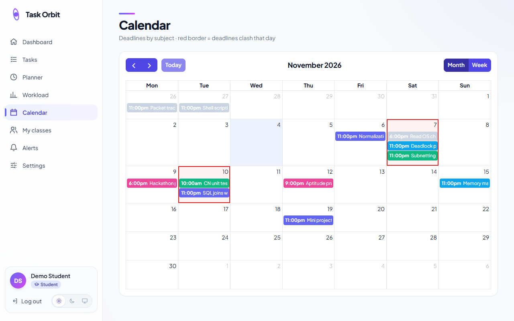

- Month and week views. Deadlines are coloured by subject; a **red outline** marks days where
  several deadlines clash.

### 2.7 My classes

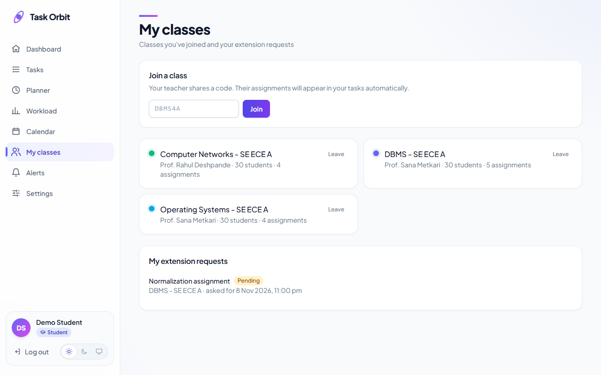

- **Join a class** with the 6-character code from your teacher. Its upcoming assignments are added
  to your tasks right away.
- **Leave** a class (its unfinished tasks are removed; finished ones stay as history).
- **My extension requests** with their status (pending, approved or rejected) and the teacher's note.

### 2.8 Alerts

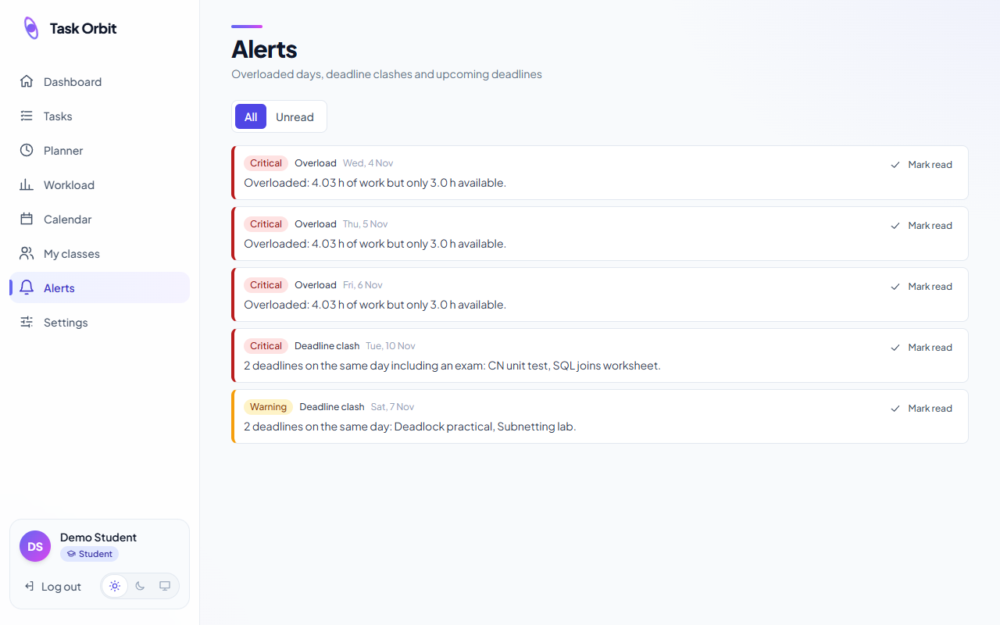

- Overloaded days, deadline clashes, due-soon or overdue tasks, new assignments from teachers, and
  extension decisions. Filter by unread and mark as read.

### 2.9 Settings and dark mode

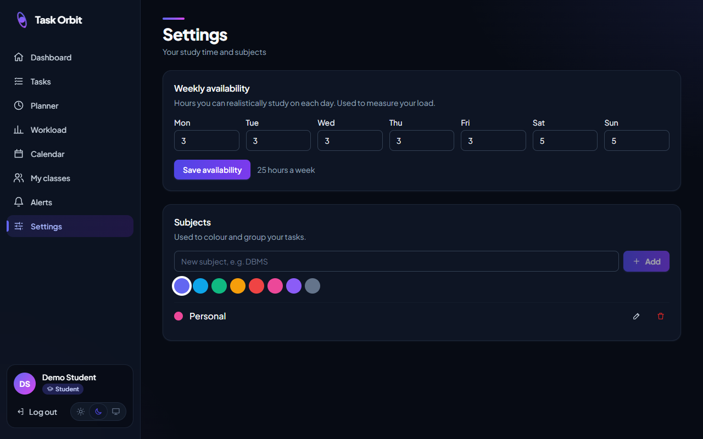

- **Weekly availability:** the hours you can study on each day of the week. Every load
  calculation uses it.
- **Subjects** for your personal tasks, with colours.
- **Theme:** Light, Dark or System, from the switch in the sidebar (or the mobile header, or the
  login page). Remembered on this device.

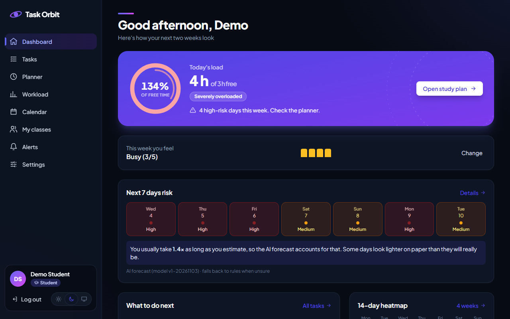

---

## 3. Teacher

### 3.1 Teacher dashboard

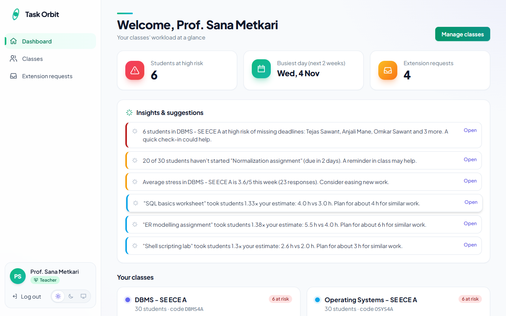

- **Students at high risk**, the **busiest day** for your classes in the next 2 weeks, and
  **pending extension requests** (click through).
- **Insights & suggestions**, generated from real data, for example:
  - *"'ER modelling' took students 1.38× your estimate; plan for about 6 h"*
  - *"20 of 30 haven't started 'Normalization' (due in 2 days)"*
- **Your classes** with a 14-day overload strip and progress bars for upcoming assignments.

### 3.2 Classes

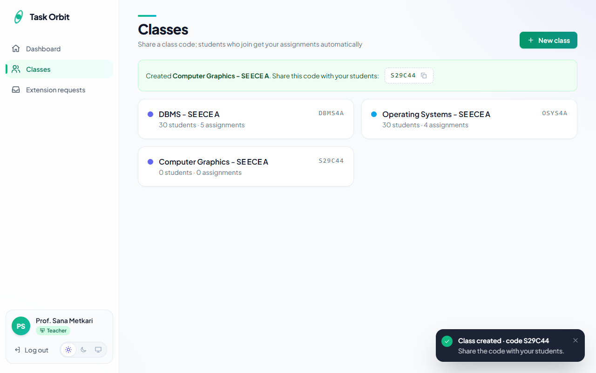

- **Create a class** (subject + class name + colour). It gets a unique 6-character **join code**;
  copy it with one click and share it with students.
- Edit or delete a class, and remove students from the roster.

### 3.3 Class analytics

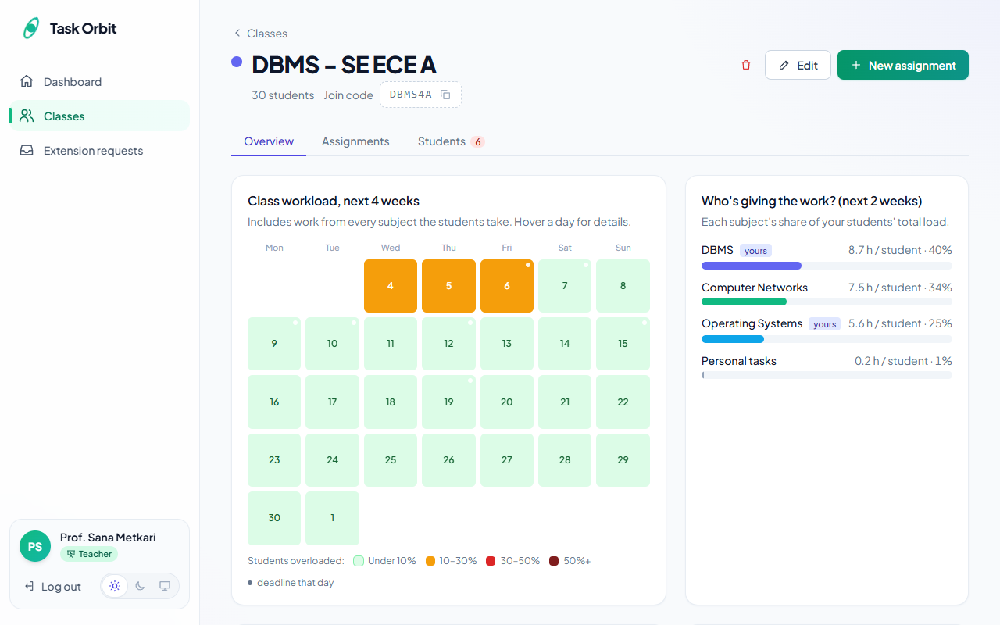

- **Class workload heatmap (4 weeks):** the % of your students overloaded on each day, counting
  **all their subjects**, not just yours. Dots mark deadline days.
- **Who's giving the work?** Each subject's share of the class's load ("is my subject the heavy one?").
- **Expected vs actual hours** per assignment, from what students logged.
- **Early warning list** and the **average stress** trend from weekly check-ins.

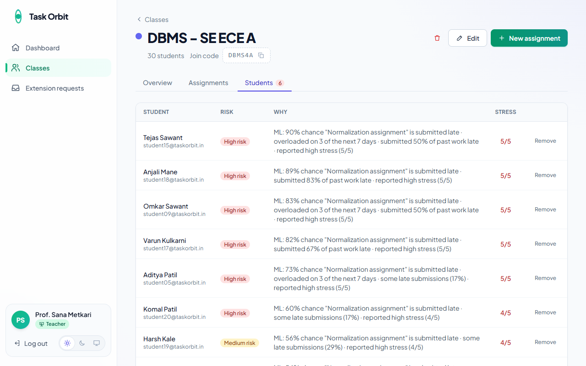

- **Students tab:** each student's risk of submitting late (ML model C), **with the reasons**:
  overloaded days, past late submissions, not started, reported stress.

### 3.4 Smart Deadline Advisor (headline feature)

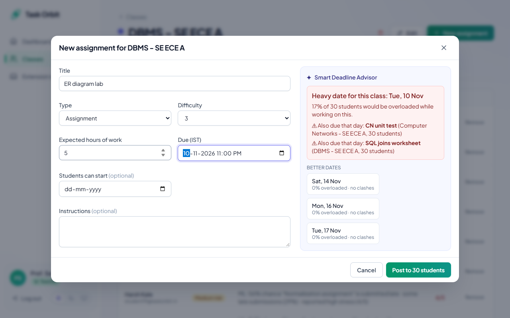

- While creating an assignment (title, type, difficulty, expected hours, due date), the advisor
  checks the proposed date against **every enrolled student's real workload**:
  - % of the class that would be overloaded while working on it,
  - other deadlines the same students already have that day (from any teacher),
  - a verdict: **good / risky / heavy**,
  - up to **3 better dates** nearby. Click one to use it.
- **Post** sends the assignment to every enrolled student (and to students who join later).

### 3.5 Assignment detail

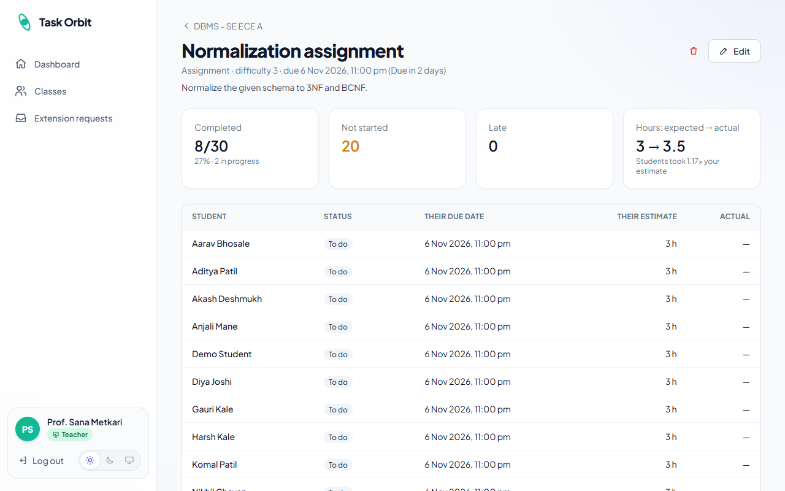

- How many have completed, not started, or submitted late, and expected vs actual average hours
  (e.g. "students took 1.17× your estimate").
- A row per student: status, **their** due date (it differs after an approved extension), their
  own estimate and the hours they actually logged.
- **Edit** the assignment. Changes reach every student, but approved extensions and students'
  own estimates are kept. Or **delete** it.

### 3.6 Extension inbox

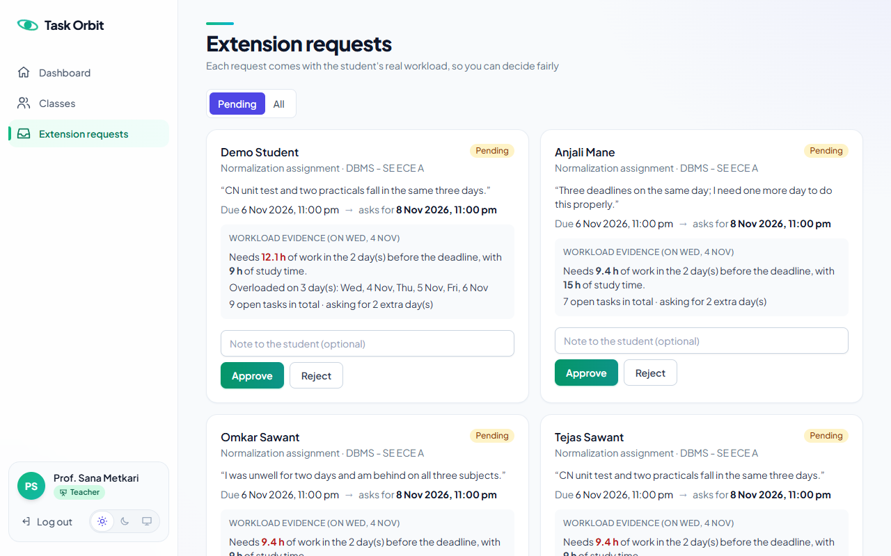

- Every request shows the student's reason and the **workload evidence** captured when they asked.
- Add a note, then **Approve** or **Reject**. Approval moves only that student's due date, and the
  student is notified.

---

## 4. The loop closes

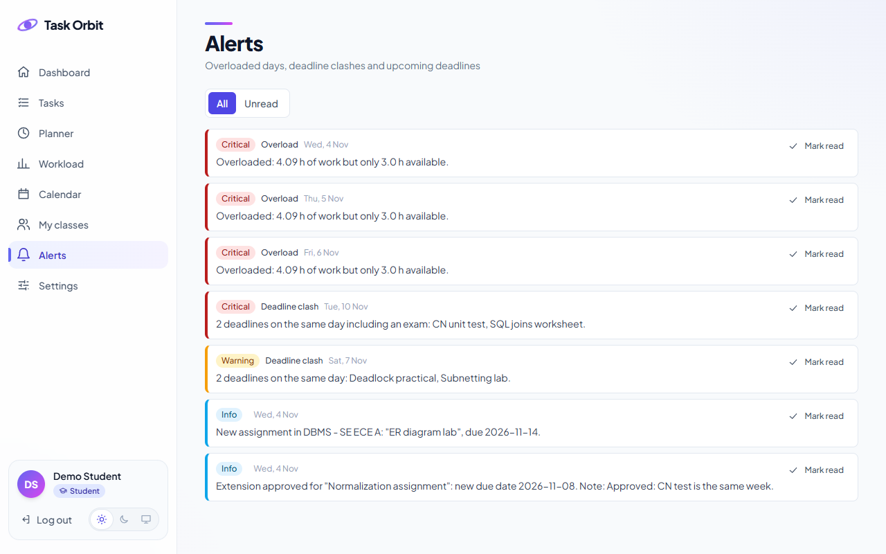

Back in the student account, the alerts show the teacher's **new assignment** and the
**approved extension** (with the teacher's note). The student can also join the new class with
its code.

---

## 5. On a phone

| Login | Dashboard | Dark mode |
|---|---|---|
| 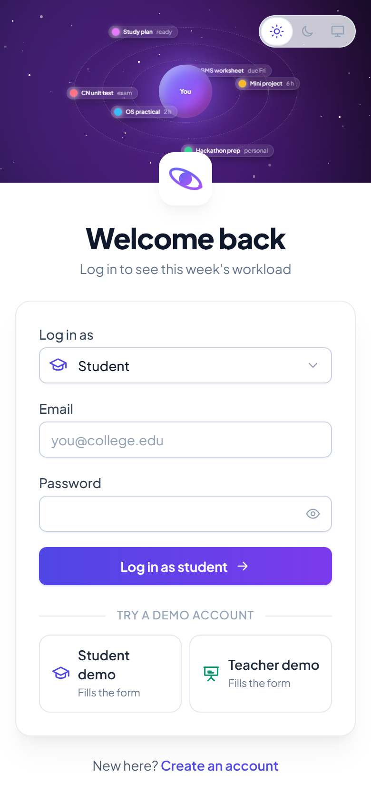 | 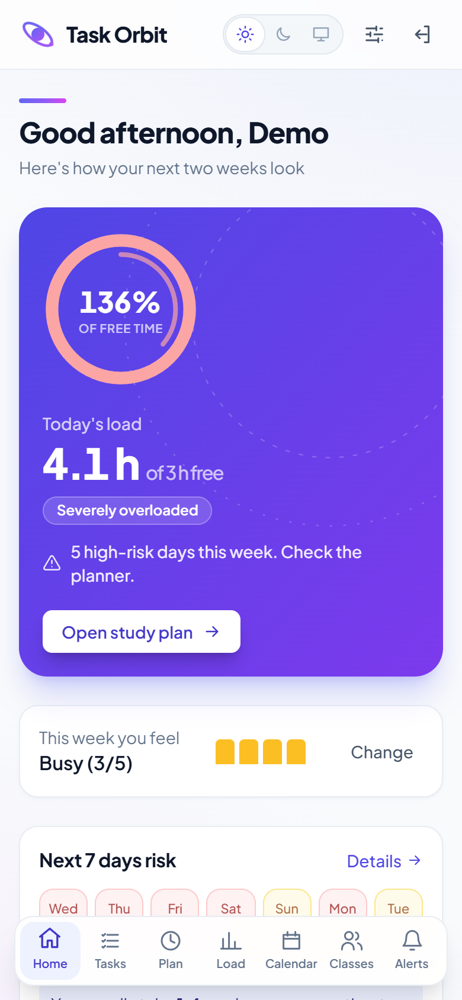 | 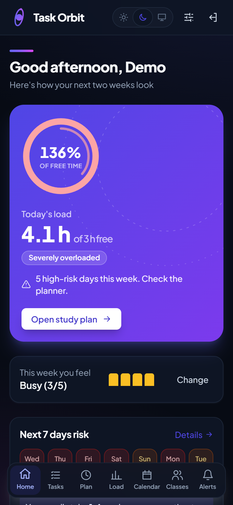 |

- A compact orbit banner on the login page, a floating bottom tab bar, and full-width cards.
- Every animation is switched off if the phone asks for reduced motion.
